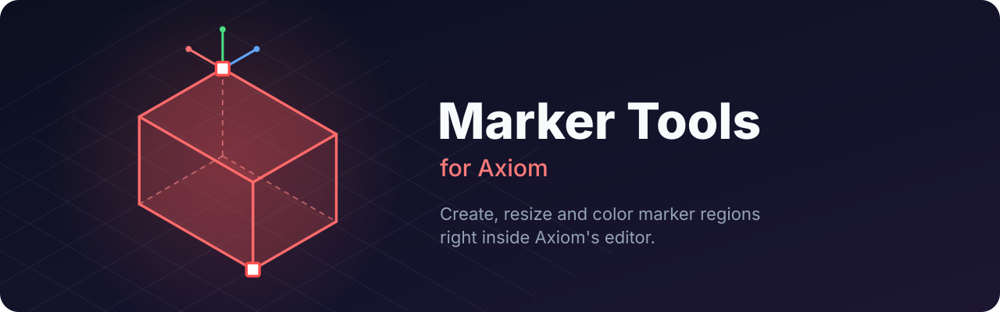

<p align="center">
  
</p>

<p align="center">
  <a href="https://github.com/italoseara/axiom-marker-tools/releases/latest"></a>
  
  
  
  <a href="LICENSE"></a>
  <a href="https://github.com/italoseara/axiom-marker-tools/releases"></a>
</p>

A client-side [Fabric](https://fabricmc.net/) add-on for [Axiom](https://axiom.moulberry.com/)
that makes marker entities easier to work with: create them from a selection, resize them with
gizmos, give them colors and names, and keep large regions visible while you work inside them.

> [!NOTE]
> This is an unofficial add-on, not affiliated with Axiom or Moulberry.

## Features

- **Marker tab** in Axiom's "create display entity" screen: creates a marker centered on you, with
  name, preset, colors, line thickness and box size.
- **Marker builder tool** next to the hotbar: left click and right click set the corners, Enter
  opens the create screen with the box fixed to the selection.
- **Marker tool** in the editor toolbar: two clicks plus Axiom's own corner gizmos.
- **Resize gizmos** on the selected marker, committed on release.
- **Better edit screen** for markers, with an RGBA color picker; the original NBT editor is one
  click away.
- **Marker range option** in the hotbar options page, measured to the nearest point of the box, so
  large regions stay visible while you are inside them.
- English and Brazilian Portuguese.

## Installation

1. Install Fabric Loader, Fabric API and Axiom for Minecraft 1.21.11.
2. Download the jar from the [latest release](https://github.com/italoseara/axiom-marker-tools/releases/latest).
3. Drop it into your `mods` folder.

## Requirements

- Minecraft 1.21.11, Fabric Loader 0.20.1+, Fabric API
- Axiom 6.1.5+ (6.1.x)
- On the server: AxiomPaper with `send-markers: true`, and the entity spawn/manipulate permissions

Markers are created and edited through Axiom's own packets, so AxiomPaper's permissions apply and
no vanilla command permissions are needed. Boxes are written relative to the marker (`~N`), so they
move with it in schematics.

## Building

Axiom is not on any Maven repository and its license does not allow redistribution, so the build
compiles against your own copy. Add the path to `gradle.properties` (gitignored):

```properties
axiomJar=/path/to/Axiom-6.1.5-for-MC1.21.11.jar
```

Then run `./gradlew build`; the jar lands in `build/libs/`.

This add-on hooks into Axiom internals with mixins, so each Axiom minor version may need an update.
The `depends` range in `fabric.mod.json` keeps it from loading on a version it was not built for.

## License

MIT
